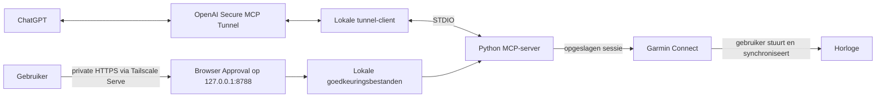

# Architectuur en beveiliging

## Twee onafhankelijke verbindingen

De OpenAI Tunnel gebruikt uitgaande HTTPS en start de lokale MCP-server over STDIO. Er is geen publieke MCP-listener. Tailscale Serve biedt uitsluitend de browserportal aan je tailnet aan; ChatGPT hoeft die URL niet te openen. De eigenaar doet dat zelf vanaf een tailnetapparaat. Tunneltoegang autoriseert toegang tot één opgeslagen Garmin-account: houd organisatie-, workspace- en pluginrechten beperkt tot deze eigenaar. Er is geen multi-useraccountmapping of publieke OAuth-service.

`mcp_server.py` registreert zes tools via de officiële Python MCP SDK. `mcp_tools.py` verzorgt validatie, filtering, lazy clients en goedkeuringscontrole. Imports/startup doen geen Garmin-login of netwerkverzoek; stdout blijft gereserveerd voor MCP. Inspector start een eigen Python-childproces. De absolute launcher `scripts/run_mcp.py` maakt starten onafhankelijk van de werkdirectory en verwijdert de OpenAI API-keyvariabelen vóór import van Garmin-code.

## De zes tools

| Tool | Verantwoordelijkheid |
|---|---|
| `get_recent_activities(limit=5)` | Recente hardloopactiviteiten; integerlimiet 1–50, alleen ID, afstand in km en duur in seconden. |
| `get_activity_details(activity_id)` | Positief integer-ID; afstand/duur en laps met index, meters en seconden; activiteit én laps bevatten gemiddelde/maximale hartslag (bpm) en loopcadans (totale stappen/min), ontbrekend als null. |
| `build_running_workout(name, steps, for_upload=false)` | Volledig offline gevalideerde Garmin-dictionary bouwen; normale uitvoer `{ok: true, workout: ...}`. `for_upload=true` geeft precies `{workout: ...}` voor Inspector. |
| `upload_running_workout(workout, approval_id=null)` | Eerst pending review aanmaken; daarna met identieke payload en oorspronkelijke, goedgekeurde ID eenmaal een **nieuwe** template aanmaken. Vereist `--enable-uploads`. |
| `schedule_running_workout(workout_id, date, approval_id=null)` | Bestaande hardlooptemplate afzonderlijk op strikte geldige `YYYY-MM-DD` zetten, na eigen review. Vereist `--enable-scheduling`; uploadt niets. |
| `upload_and_schedule_running_workout(workout, date, approval_id=null)` | Browser-only: één exacte toestemming voor upload én planning. Beide enable-flags vereist. Duurzaam journaal voorkomt opnieuw uploaden; alleen `scheduled` bevestigt voltooiing. |

Stappen zijn warmup, interval, recovery of cooldown, met exact één einde: meters of seconden. Hoogstens één doel: open, exact tempo in seconden/km (Garmin m/s = `1000 / seconds_per_km`), exact/ranged integer BPM 1–300 of ingestelde HR-zone 1–5. Native repeatblokken bevatten 1–100 herhalingen, niet-lege kinderen, maximaal vier repeatniveaus en samen maximaal 100 opgeslagen nodes. Elk kind loopt bij iedere herhaling, inclusief herstel bij de laatste. Unieke stapvolgorde is depth-first; geen automatische herstelstappen. Dit zijn connectorlimieten. Geavanceerde payloads zijn offline met de geïnstalleerde library gecontroleerd; live Garmin/deviceondersteuning daarvan is niet bewezen. Zie [voorbeelden en bibliotheekdetails](REFERENCE.md).

## Goedkeuring als aparte vertrouwensgrens

Uploads/planning zijn standaard uit. Inschakelen staat aanvragen toe, nooit zelfgoedkeuring. Terminalmodus blijft standaard, met een mens die letterlijk `UPLOAD` of `SCHEDULE` typt. Browsermodus vereist een private HTTPS-origin en gebruikt afzonderlijke state.

De browserportal controleert onafhankelijk HTTP Basic-authenticatie als `owner` tegen de lokale scrypt-hash. Iedere review en beslissing vereist authenticatie. Een succesvolle POST vereist bovendien exact dezelfde Origin-string als de geconfigureerde HTTPS-origin, een CSRF-HMAC gebonden aan operatie, verzoek-ID, payloadhash en vervaltijd, en de beoordeelde SHA256. De Host-hostnaam wordt vergeleken met de origin-hostnaam; de code vergelijkt hier niet de volledige Host inclusief poort. Forwarded headers worden niet vertrouwd. De reverse proxy moet de oorspronkelijke Host, Origin en Authorization behouden.

GET toont alleen een HTML-geëscapete samenvatting en payload. Alleen een expliciete actiespecifieke POST kan goedkeuren of afwijzen. HTML is niet framebaar, heeft strikte CSP, geen externe inhoud, `no-store`, `no-cache`, `nosniff`, HSTS en uitgeschakelde access logging. Tien mislukte authenticatiepogingen binnen zestig seconden blokkeren verdere authenticatie per proces; dit is geen gedeelde of duurzame rate limiter.

Toestemming blijft tien minuten geldig vanaf aanvraag, bindt exact de payload en wordt atomair eenmaal verbruikt **vóór** Garmin-authenticatie/reads/writes. Ook fouten verbruiken de toestemming. Geen MCP approve/reset-tool, modelboolean, elicitation, chat-akkoord of native ChatGPT-confirmatie kan die toestemming vervangen. De portal roept Garmin nooit aan. Agents mogen echte reviewpagina's niet bedienen of approval-state wijzigen om toestemming te verlenen.

## Opgeloste `Origin: null`-fout

De code gebruikt nog steeds `Referrer-Policy: strict-origin-when-cross-origin`. Met de vroegere `no-referrer`-waarde stuurde Chrome tijdens de handmatige test `Origin: null` bij het formulier; de exacte Origin-controle gaf terecht `403 Invalid origin`. Na de headerwijziging werkte de browsergoedkeuring volgens de eigenaar.

Voor POST buiten de CORS-route schrijft de Fetch-standaard bij policy `no-referrer` een geserialiseerde Origin van `null` voor. Bij `strict-origin-when-cross-origin` blijft de echte Origin behouden zolang HTTPS niet naar HTTP wordt teruggebracht. De nieuwe policy behoudt dus bij dezelfde HTTPS-origin de benodigde herkomstinformatie; bij cross-origin navigatie deelt zij alleen de origin en bij HTTPS→HTTP geen referrer. Dit verklaart de waargenomen oplossing, maar garandeert niet dat iedere browser altijd Origin verzendt. `Origin` en `Referer` zijn verschillende headers: de server blijft alleen de exacte Origin accepteren. `null`, ontbrekende of vreemde origins blijven geweigerd; er is geen fallback of wildcard. Zie de primaire [Fetch-standaard: Origin-header](https://fetch.spec.whatwg.org/#append-a-request-origin-header).

De trade-off: `strict-origin-when-cross-origin` onderdrukt niet alle referrers. Bij same-origin navigatie kan het reviewpad met verzoek-ID als Referer meegaan. De portal laadt daarom geen externe inhoud, verbiedt framing en caching, en proxylogs mogen geen reviewpaden, credentials of requestbodies vastleggen. De regressietests controleren de gekozen header en het blijven weigeren van `Origin: null`; ze simuleren HTTP en bewijzen geen echte Chrome-headergeneratie.

## Planning en onzekere uitkomsten

Na toestemming valideert de server de bestaande running-template en controleert `get_scheduled_workouts_by_period(date, date)`. Onbekende kalenderstructuren stoppen veilig. Een bestaande passende entry voorkomt POST. Vóór POST claimt de server atomair een duurzame poging voor workout-ID/datum, gedeeld over browser- en terminalmodus. De library krijgt `schedule_workout(workout_id, date_str)` en verstuurt `{"date": date_str}`.

Het attemptrecord blijft bestaan bij succes en onzekerheid, ook na herstart. Geen automatische retry of MCP-reset. Agents mogen records nooit verwijderen om blokkades te omzeilen. Alleen een mens kan de echte Garmin-toestand reconciliëren en zo nodig een specifiek record administratief behandelen. Externe/manual clients kunnen tussen remote controle en POST nog racen: dit is geen wereldwijd exactly-once-systeem. De applicatie doet geen automatische schrijfretries; de Garmin-library kan intern authenticatie vernieuwen en een HTTP 401 opnieuw proberen. Upload/planning zijn geen transactie: een template kan bestaan terwijl planning mislukt.

## Opslag en geheimen

| Locatie | Inhoud en bescherming |
|---|---|
| `~/.garminconnect` | Garmin-sessies; buiten repo, map privé houden. |
| `~/.config/garmin-connector/browser-auth.json` | Alleen salt/digest, mode 600 vereist bij laden; geen plaintext wachtwoord. |
| `~/.config/tunnel-client` of XDG-configlocatie | Tunnelprofielen; gebruik env-referenties, geen literal keys. |
| `~/.local/state/garmin-connector/approvals` | Terminal-uploadstate; nieuw aangemaakt mappen 700, bestanden 600. |
| `.../approvals/scheduling` | Terminal-planningstate én gedeelde duurzame attemptrecords. |
| `.../approvals/browser/upload` en `.../browser/schedule` | Browserstate, gescheiden van terminalgoedkeuring. |

Beide processen moeten als dezelfde vertrouwde lokale gebruiker dezelfde standaardstate gebruiken. Andere auth-file verandert de state-root niet. Portalherstart maakt oude CSRF-formulieren ongeldig: herladen en opnieuw beoordelen; al verleende toestemmingen blijven tot hun oorspronkelijke vervaltijd bruikbaar.

Lokale processen en bestanden van dezelfde OS-gebruiker zijn vertrouwd: arbitraire shell-/bestandstoegang kan goedkeuringsstate manipuleren. Geef agents die bevoegdheid of het portalwachtwoord niet. Een private tailnetroute plus Basic-auth is geschikt voor deze opzet met één eigenaar; het is geen publieke internetdienst. TLS, private ACL's en private tunnelrechten zijn vereisten. De huidige Serve-route is tailnet-only; tailnet-ACL's en OpenAI-accountrechten zijn hier niet volledig geaudit.

MCP-resultaten zijn allowlisted: geen GPS, ruwe activiteiten/kalenders/profielen, credentials, sessietokens of ruwe Garmin-responses. Trainingsnaam, gefilterde statistieken, gevraagde datum en reviewlink komen wel in ChatGPT en vallen onder de daar geldende gegevens-/logregels. Deze filtering geldt voor MCP; de bestaande handmatige CLI kan uitgebreidere uitvoer tonen. Deel die niet ongeredigeerd. Zie [rotatie en herstel](TROUBLESHOOTING.md#geheimen-vervangen).

## Gecombineerd journaal

`combined.py` bindt `{action, workout, date}` met bestaande canonieke hashing.
`browser/combined` bevat aparte consentbestanden en een journal/lock per payloadhash.
Een flock over het hele uitvoeringspad serialiseert processen en threads, ook bij
verschillende approval IDs. Tempfile + fsync + atomic replace + directory-fsync
leggen elke fase vast. `upload_started` wordt vóór upload opgeslagen en blokkeert
herhaling bij crash/unknown response; het ID wordt direct na upload bewaard.
Planning gebruikt dezelfde attempt-ledger als standalone terminal/browser en
controleert eerst running-template en strikt herkende kalenderrespons.

Verbruikte gecombineerde toestemming blijft alleen bruikbaar voor expliciete
hervatting van ontbrekende stappen binnen de oorspronkelijke tien minuten;
geen herhaalde writes. Vóór elke nieuwe write wordt de vervaltijd opnieuw getoetst.
Na expiry is verse onafhankelijke browserreview nodig voor dezelfde inputs en
hetzelfde journaal. Onzekere planning mag alleen kalenderbewijs verzamelen;
onzekere upload vereist handmatige reconciliatie. Geen resettool of automatische
retry. Remote/manual races blijven mogelijk. Live gecombineerde Garmin-acceptatie
is nog niet geverifieerd. Zie STARTUP voor gebruikersworkflow.
